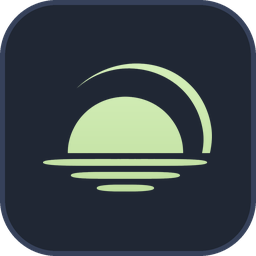
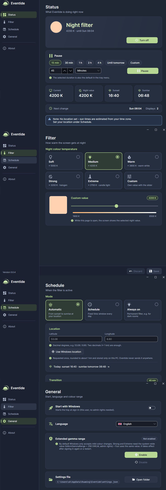

# Eventide

Eventide changes the colour temperature of all your displays the same way f.lux does, through the display gamma ramp. The blue share is reduced; red and green mostly stay. You decide when this happens: automatically between sunset and sunrise at your location, in a fixed time window (e.g. 21:00 – 07:00), or all the time. The tray icon shows the state at a glance, a left click switches the filter on or off, and a right click opens the menu with the settings on top.



## Features

- **Three modes**
  - *Automatic*: sunset → sunrise, calculated locally for your location (NOAA algorithm).
  - *Schedule*: a fixed time window.
  - *Always on*: for dark rooms.
- **Soft transitions.** The filter fades in after the start and out before the end of the night window, over 0–120 minutes (default 45). Switching on and off also fades for about one second.
- **Five intensities plus your own value.**
  - Soft ≈ 5000 K, Medium ≈ 4200 K (default), Warm ≈ 3800 K, Strong ≈ 3200 K (halogen look), Extreme ≈ 2700 K (candle light).
  - In the settings: any value from 1900 to 6500 K, with a live preview on your screen.
- **Tray icon as indicator.** Accent green when the filter is on, grey when it is off, grey with a green dot when it is paused. The icon adapts to a light or dark taskbar.
- **Pause** for 15 min, 30 min, 1 h (default), 2 h, 4 h, until tomorrow (morning) or your own duration in minutes or hours, useful for photo editing or games. The duration you pick in the settings is the default in the tray menu. *Resume* is right in the menu.
- **Start with Windows.** Can be switched on and off in the tray menu and in the settings.
- **All displays.** Every monitor gets its own ramp. Your calibration stays intact and is restored when Eventide quits.
- **Smart hints.** Eventide notices when:
  - Windows limits the colour range,
  - HDR is on (gamma ramps don't work in HDR),
  - the Windows Night light is also on,
  - you are in a remote session (RDP / Citrix).
- **English and German.** Chosen automatically from the Windows display language; you can switch it in the settings without a restart.
- **Small footprint.** The tray runs on Windows Forms. The settings window (Avalonia) is a separate process that starts only when you open it and frees all of its memory when you close it.

## How to use it

| Action | What happens |
| --- | --- |
| **Left click** on the tray icon | Filter on / off (ends a pause) |
| **Right click** on the tray icon | Menu: **Settings…**, status, **Disable filter / Enable filter** (one button), mode, intensity, pause / resume, start with Windows, exit |
| **Start Eventide.exe again** | Opens the settings window of the running Eventide |
| Settings › **Status** | What Eventide is doing right now, on / off button, **pause card** (durations, own duration, resume), current and night temperature, sunset / sunrise, next change, notes and warnings |
| Settings › **Filter** | Intensity cards, slider for your own value, live preview while the page is open |
| Settings › **Schedule** | Mode, location (or *Use Windows location*), time window, transition |
| Settings › **General** | Start with Windows (on by default), language (English / German with flags), extended gamma range, settings folder |

**Save** (right) and **Discard** (left) apply to the *Schedule* and *Filter* pages. Everything on *General* takes effect immediately.

## Extended gamma range (Strong / Extreme)

Out of the box, Windows only accepts mild changes of the gamma ramp. Warm values below about 4000 K need the system-wide registry value

```
HKEY_LOCAL_MACHINE\SOFTWARE\Microsoft\Windows NT\CurrentVersion\ICM
GdiIcmGammaRange = 256 (DWORD)
```

f.lux and similar tools use the same value.

- **Installer:** a separate page explains the value and enables it, checked by default.
- **Settings:** you can also enable it later under *General › Extended gamma range*, after a UAC prompt.

The value takes effect **after signing in again or a restart**. Until then, Eventide uses the warmest value Windows accepts and tells you so on the status page. When you uninstall Eventide, the value is removed only if Eventide set it.

## Installation

- **Installer:** `eventide_v0.0.4_setup.exe`. It offers the options *Start with Windows* and *Extended gamma range*.
- **Portable:** unpack `eventide_v0.0.4_portable.zip` and start `Eventide.exe`. The file `Eventide.portable` next to the EXE keeps the settings in `data\` beside it.

On the first start Eventide adds itself to the Windows autostart (for the current user, no admin rights needed) and shows a short hint. You can switch the autostart off in the menu.

Requirements: Windows 10 (1809) or Windows 11, 64-bit. The release builds are self-contained, so no separate .NET installation is needed.

## Notes

- **HDR displays:** Windows ignores gamma ramps while HDR is on. Eventide has no effect there and shows a hint.
- **Games in exclusive full screen** may reset the ramp. Eventide re-applies it every 30 seconds while the filter is active; use *Pause* if you need true colours.
- **Remote sessions** (RDP, Citrix): gamma ramps are not available, so Eventide stays inactive.
- **Windows Night light:** if it is on at the same time, the screen gets tinted twice. Use one of the two.
- **Location:** entered by hand or requested once from Windows, rounded to about 1 km and stored only on this PC. Without a location, Eventide estimates the sun times from your time zone.
- **Privacy:** Eventide makes no network connections. See [licenses/PRIVACY.md](licenses/PRIVACY.md).

## License

Eventide is released under the **MIT License**. Copyright © 2026 Sven Klocke (*sksdesign | complicatiion*). See [licenses/](licenses/) for the license, legal notes and the third-party licenses (.NET, Avalonia, CommunityToolkit.Mvvm, Inter, Material Design Icons).

**Links:** [sksdesign.de](https://sksdesign.de) · [GitHub](https://github.com/complicatiion/Eventide)
